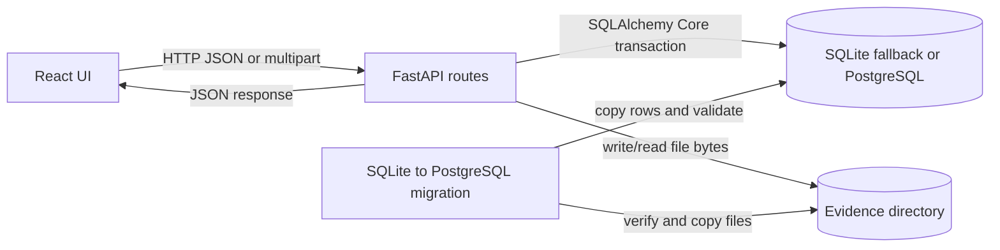

# Database architecture

## Responsibilities

- **React frontend:** collects input, sends HTTP requests, and renders API
  responses. It does not access the database directly.
- **FastAPI backend:** validates API payloads, runs application rules, records
  case/evidence/finding/timeline changes, and returns JSON.
- **SQLAlchemy Core:** selects SQLite or PostgreSQL from `DATABASE_URL`, defines
  the relational tables/indexes, and scopes API work in transactions.
- **SQLite/PostgreSQL:** stores investigation records, evidence metadata,
  findings, analysis runs and indicators, and timeline events.
- **Evidence directory:** stores file bytes; its database row stores a stable
  generated filename and SHA-256 for verification.

## Architecture and data flow

## Entity relationships

An investigation may be linked to zero or more evidence records, findings, and
timeline events. Those records can also be unlinked because their `case_id`
columns are nullable. An evidence record may have multiple analysis runs; each
run belongs to exactly one evidence record. An analysis run may return zero or
more ordered indicators. The editable ER view is `02-er-diagram.mmd`.

## Transactions and error handling

Each write route uses `get_db()`; successful exit commits all related database
rows together. Exceptions roll back the database transaction. API routes
validate foreign-key parents before inserting user input, while actual foreign
keys prevent invalid references from other code paths. Evidence upload also
removes a newly written file if the database insert fails. Analysis results
and indicators are inserted within the same database transaction.

## Migration strategy

SQLite remains the no-configuration fallback. Existing SQLite tables stay in
place, and the startup migration only rebuilds `analysis_runs` to replace its
legacy indicator JSON column with a child table. To move a whole workspace,
run the explicit SQLite-to-PostgreSQL migration command against an empty target
after backing up both the database and evidence directory. The source is left
unchanged and the migration checks hashes and row counts.
